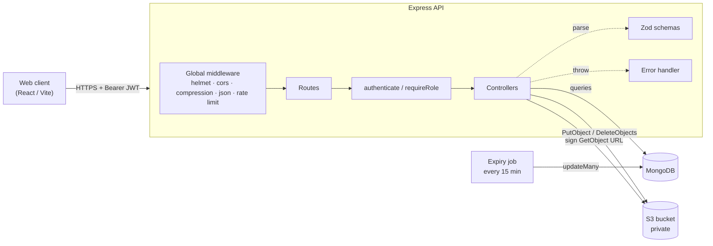
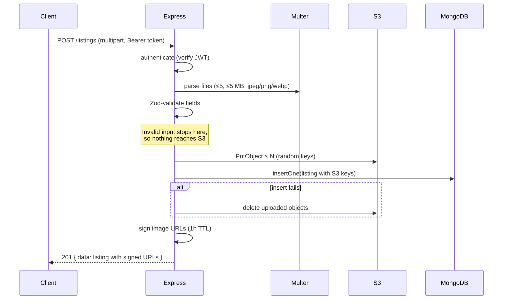
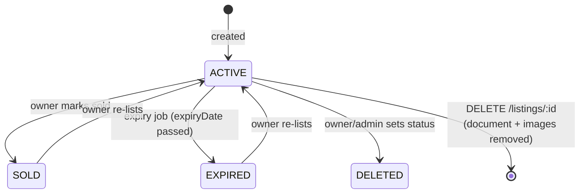

# LastCall Marketplace API

REST API for **LastCall**, a local marketplace where people sell, swap or give away items before they're thrown out. Users list items with photos and an expiry date. Buyers browse and search active listings. A background job retires listings once they expire.

Built with **Express 5 + TypeScript**, **MongoDB**, **AWS S3** (private bucket, signed URLs) and **JWT** auth. Covered by an integration test suite that runs without any cloud credentials.

---

## Highlights

- **JWT authentication** with bcrypt password hashing, role-based access (`USER` / `ADMIN`) and constant-time login responses to prevent account enumeration
- **Owner-scoped authorization:** only a listing's owner (or an admin) can edit, re-status or delete it
- **Image uploads to a private S3 bucket:** files are validated (type, size, count), stored under random keys and served to clients as short-lived signed URLs
- **Paginated listing feed and full-text-style search** across title, description and category, with escaped input (no regex injection / ReDoS)
- **Automatic expiry:** a cron job flips `ACTIVE` listings to `EXPIRED` every 15 minutes
- **Admin dashboard:** user and listing statistics from a single aggregation pipeline
- **Defense in depth:** Zod validation on every input, Helmet, CORS allow-list, global + per-route rate limiting, request size limits, centralized error handling that never leaks stack traces
- **Fail-fast config:** environment variables are validated at startup with clear error messages

---

## Tech Stack

| Layer      | Choice                                                 |
| ---------- | ------------------------------------------------------ |
| Runtime    | Node.js ≥ 20, TypeScript (strict)                      |
| Framework  | Express 5                                              |
| Database   | MongoDB (official driver)                              |
| Storage    | AWS S3 (`@aws-sdk/client-s3`, presigned URLs)          |
| Auth       | JSON Web Tokens (HS256), bcryptjs                      |
| Validation | Zod 4                                                  |
| Security   | Helmet, CORS, express-rate-limit                       |
| Uploads    | Multer (in-memory, streamed to S3)                     |
| Jobs       | node-cron                                              |
| Testing    | Vitest, Supertest, mongodb-memory-server               |
| Tooling    | ESLint (typescript-eslint), tsx                        |

---

## Architecture



### Request lifecycle: creating a listing



### Listing lifecycle



### Project structure

```
src/
├── server.ts            # Entry point: connect DB, create indexes, start cron + HTTP, graceful shutdown
├── app.ts               # createApp(): middleware, routes, error handling (no side effects, used by tests)
├── config/
│   ├── env.ts           # Zod-validated environment variables
│   ├── db.ts            # MongoDB client + collection names
│   ├── indexes.ts       # Index definitions
│   └── s3.ts            # Upload, delete and URL signing
├── controllers/         # Request handlers grouped by domain (auth, users, listings, admin)
├── middleware/          # authenticate/requireRole, rate limits, uploads, logger, error handler
├── jobs/                # Scheduled tasks (listing expiry)
├── routes/              # Route table
├── schemas/             # Zod request schemas
├── types/               # Express request augmentation
└── utils/               # HttpError, JWT helpers, ObjectId parsing
tests/                   # Integration tests (in-memory MongoDB, mocked S3)
```

---

## Getting Started

### Prerequisites

- Node.js 20 or newer
- A MongoDB database (e.g. a free MongoDB Atlas cluster)
- An AWS S3 bucket with an IAM user/role allowed to `s3:PutObject`, `s3:GetObject` and `s3:DeleteObject`

### Installation

```bash
git clone https://github.com/Pcharlesme/StoreBackend.git
cd StoreBackend
npm install
cp .env.example .env   # then fill in real values
npm run dev
```

The API runs on `http://localhost:3000`. Check it with `curl localhost:3000/health`.

### Environment variables

| Variable                | Required | Default                 | Description                                                         |
| ----------------------- | :------: | ----------------------- | ------------------------------------------------------------------- |
| `NODE_ENV`              |          | `development`           | `development`, `production` or `test`                               |
| `PORT`                  |          | `3000`                  | HTTP port                                                           |
| `MONGODB_URI`           |    ✅    |                         | MongoDB connection string                                           |
| `MONGODB_DB_NAME`       |          | `storeApp`              | Database name                                                       |
| `JWT_SECRET`            |    ✅    |                         | Signing secret, **≥ 32 chars** (`openssl rand -base64 48`)          |
| `JWT_EXPIRES_IN`        |          | `7d`                    | Token lifetime (`15m`, `12h`, `7d`, ...)                            |
| `CORS_ORIGINS`          |          | `http://localhost:5173` | Comma-separated allowed origins                                     |
| `TRUST_PROXY`           |          | `0`                     | Proxy hops to trust; set to `1` behind Render/Heroku/Nginx          |
| `AWS_REGION`            |    ✅    |                         | Bucket region                                                       |
| `AWS_S3_BUCKET`         |    ✅    |                         | Bucket name (keep it private)                                       |
| `AWS_ACCESS_KEY_ID`     |          |                         | Omit to use the default AWS credential chain (IAM role, profile)    |
| `AWS_SECRET_ACCESS_KEY` |          |                         | Paired with the key above                                           |

The server refuses to start if a required variable is missing or invalid.

### Scripts

| Command              | Description                                      |
| -------------------- | ------------------------------------------------ |
| `npm run dev`        | Start with hot reload (tsx)                      |
| `npm run build`      | Compile to `dist/`                               |
| `npm start`          | Run the compiled build                           |
| `npm test`           | Run the integration test suite                   |
| `npm run test:watch` | Tests in watch mode                              |
| `npm run lint`       | ESLint                                           |
| `npm run typecheck`  | TypeScript without emitting                      |
| `npm run check`      | Typecheck, lint, test and build (CI-ready)       |

---

## Testing

```bash
npm test
```

Tests run the real Express app against an **in-memory MongoDB** (`mongodb-memory-server`) with S3 replaced by an in-process fake, so no database, AWS account or `.env` is needed. The first run downloads a MongoDB binary (~70 MB), which is cached afterwards.

The suite covers:

- signup/login, duplicate emails, weak passwords, NoSQL operator injection, uniform login errors
- token handling (missing, malformed, invalid)
- listing creation from multipart data, validation before any upload, image type checks
- pagination clamping, search matching and regex-escaping
- **ownership enforcement:** non-owners get `403` for update, status change and delete; admins are allowed
- S3 cleanup on listing and account deletion
- public profile field filtering (no email, phone, address or role)
- admin dashboard access control and aggregation
- the expiry job

---

## API Reference

All responses are JSON with a consistent envelope:

```jsonc
// success
{ "success": true, "message": "optional", "data": { ... } }

// error
{ "success": false, "message": "Validation failed", "errors": [{ "field": "password", "message": "..." }] }
```

Protected routes need `Authorization: Bearer <accessToken>`.

### Auth

| Method | Path           | Auth | Description                          |
| ------ | -------------- | :--: | ------------------------------------ |
| POST   | `/auth/signup` |      | Create an account (rate limited)     |
| POST   | `/auth/login`  |      | Get an access token (rate limited)   |

```http
POST /auth/signup
Content-Type: application/json

{ "email": "jane@example.com", "password": "Password123" }
```

Password rules: 8–72 characters, at least one uppercase letter and one number.

```http
POST /auth/login
```

```json
{
  "success": true,
  "message": "Logged in successfully",
  "data": {
    "accessToken": "eyJhbGciOi...",
    "user": { "id": "665f...", "email": "jane@example.com", "role": "USER" }
  }
}
```

### Listings

| Method | Path                    |   Auth    | Description                                       |
| ------ | ----------------------- | :-------: | ------------------------------------------------- |
| GET    | `/listings`             |           | Active listings, paginated                        |
| GET    | `/listings/search`      |           | Search active listings                            |
| GET    | `/listings/:id`         |           | Single listing                                    |
| POST   | `/listings`             |    ✅     | Create a listing (multipart)                      |
| PATCH  | `/listings/:id`         | owner/admin | Update fields                                   |
| PATCH  | `/listings/status/:id`  | owner/admin | Set `ACTIVE`, `SOLD`, `EXPIRED` or `DELETED`    |
| DELETE | `/listings/:id`         | owner/admin | Delete listing and its images                   |

**Query parameters** for `GET /listings` and `/listings/search`: `page` (default 1), `limit` (default 10, max 50), `search` (max 100 chars, matches title, description and category).

```json
{
  "success": true,
  "data": [{ "_id": "...", "title": "Wooden chair", "images": ["https://<signed-url>"], "...": "..." }],
  "pagination": { "total": 42, "page": 1, "limit": 10, "totalPages": 5 }
}
```

**Create listing** (`multipart/form-data`):

| Field         | Type                     | Notes                                |
| ------------- | ------------------------ | ------------------------------------ |
| `title`       | string                   | 3–100 chars                          |
| `description` | string                   | 10–600 chars                         |
| `type`        | `FREE` · `SELL` · `SWAP` |                                      |
| `price`       | number                   | ≥ 0                                  |
| `category`    | string                   |                                      |
| `expiryDate`  | ISO date                 | must be in the future                |
| `location`    | JSON string              | `{"city":"London"}`                  |
| `images`      | file(s)                  | 1–5 × JPEG/PNG/WebP, ≤ 5 MB each     |

```bash
curl -X POST http://localhost:3000/listings \
  -H "Authorization: Bearer $TOKEN" \
  -F title="Wooden chair" -F description="Solid oak, barely used" \
  -F type=SELL -F price=25 -F category=furniture \
  -F expiryDate=2030-01-01 -F 'location={"city":"London"}' \
  -F images=@chair.jpg
```

### Users

| Method | Path                 | Auth | Description                                             |
| ------ | -------------------- | :--: | ------------------------------------------------------- |
| GET    | `/users/me`          |  ✅  | Own profile                                             |
| PATCH  | `/users/me`          |  ✅  | Update `fullname`, `contactno`, `gender`, `address`, `location` |
| DELETE | `/users/me`          |  ✅  | Delete account, its listings and their images           |
| GET    | `/users/me/listings` |  ✅  | Own listings (all statuses)                             |
| GET    | `/users/:id`         |      | Public profile: name, city/country, join date only      |

### Admin

| Method | Path               | Auth  | Description                                  |
| ------ | ------------------ | :---: | -------------------------------------------- |
| GET    | `/admin/dashboard` | ADMIN | User count, listings by status and by type   |

Admins are promoted directly in the database:

```js
db.user.updateOne({ email: "you@example.com" }, { $set: { role: "ADMIN" } })
```

The role is embedded in the JWT, so the user has to log in again for the change to take effect.

### Status codes

| Code | Meaning                                            |
| ---- | -------------------------------------------------- |
| 200 / 201 | Success / created                             |
| 400  | Validation failed, malformed id or JSON           |
| 401  | Missing, invalid or expired token; bad credentials |
| 403  | Authenticated but not allowed (not owner / not admin) |
| 404  | Resource or route not found                       |
| 409  | Email already registered                          |
| 429  | Rate limit exceeded                               |
| 500  | Unexpected server error (details logged, not returned) |

---

## Security Notes

- Secrets live only in environment variables. `.env` and `config.env` are git-ignored, and `.env.example` holds placeholders only.
- The S3 bucket should **block all public access**. The API hands out signed GET URLs valid for one hour.
- Rate limits: 300 requests / 15 min per IP globally, 5 failed logins / 15 min, 10 signups / hour.
- When deploying behind a proxy, set `TRUST_PROXY` so rate limiting keys on the real client IP.

## Roadmap

- Refresh tokens and token revocation
- Google sign-in
- OpenAPI / Swagger documentation
- Favorites, reservations and in-app chat
- Notifications when a listing is about to expire

## License

[MIT](LICENSE) © Pcharles
